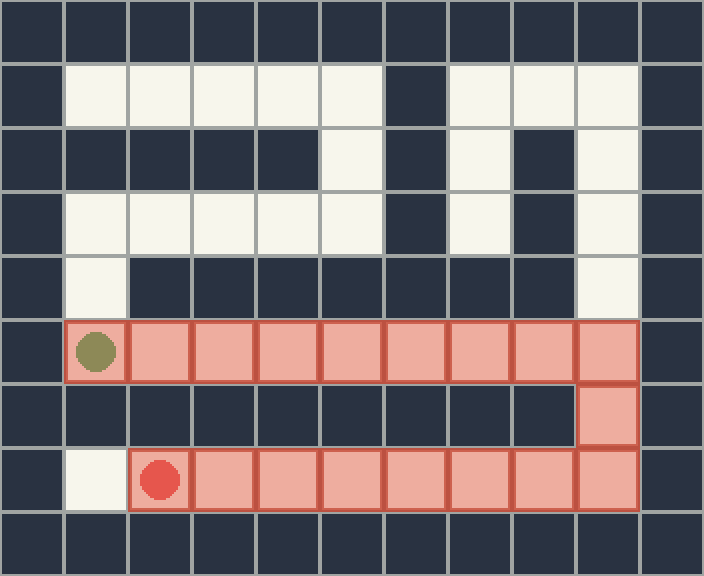
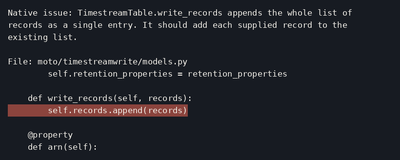
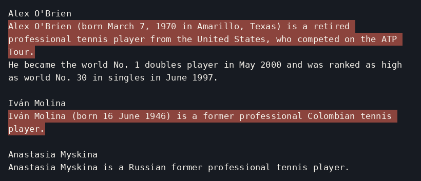
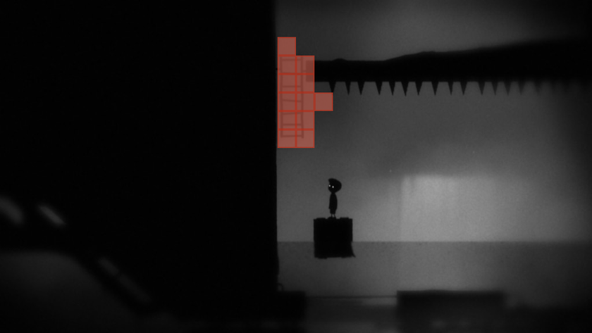

# SEL

SEL selects relevant text tokens and image patches in a single model forward
pass. Send a question and a source to the server. It returns scores with
character ranges for text and pixel boxes for images.

[SEL Qwen 0.8B](https://huggingface.co/spock-oss/sel-qwen-0.8b) ·
[SEL Qwen 9B](https://huggingface.co/spock-oss/sel-qwen-9b) ·
[Selection as a model shape](https://spock.one/blog/selection-is-a-model-shape)

## Examples

### Maze

Select every square on the shortest path from red to green.



### SWE-Gym

Select the existing line of code that needs to change to fix the reported issue.



### HotpotQA

Which former tennis player played for the United States, Iván Molina or Alex O’Brien? Select the supporting sentences.



### Game

What can I use to climb?



Sources include [SWE-Gym](https://github.com/SWE-Gym/SWE-Gym) and [Moto](https://github.com/getmoto/moto), [HotpotQA](https://hotpotqa.github.io/) ([CC BY-SA 4.0](https://creativecommons.org/licenses/by-sa/4.0/)), and [LIMBO](https://playdead.com/games/limbo/) by Playdead.

[Interactive examples](https://spock.one/blog/selection-is-a-model-shape#sel-examples)

## Quickstart

On Linux with an NVIDIA GPU, install the tested vLLM runtime.

```sh
git clone https://github.com/spock-oss/sel.git
cd sel
uv venv --python 3.14
source .venv/bin/activate
uv pip install --torch-backend=auto 'vllm==0.33.0' 'transformers==5.20.2' \
  fastapi uvicorn pillow huggingface-hub safetensors

python serve.py spock-oss/sel-qwen-0.8b
```

`serve.py` downloads the adapter, dense selection head, and pinned Qwen
base. Use `python serve.py spock-oss/sel-qwen-9b --fp8` for 9B on an
FP8-capable GPU. The server defaults to `127.0.0.1:8000`.

In another terminal, activate the same environment and run:

```sh
python example.py
```

The client sends a text request, an image request, and a mixed request.
It generates the example image locally.

## API

`POST /select` accepts JSON with a `question` and one or both of `text`
and `image_base64`. The optional `threshold` sets the selection cutoff.
Each result unit contains a score, a selection flag, and its position in
the source. Inputs are limited to 2,048 tokens, including the question,
prompt formatting, and image patches.
